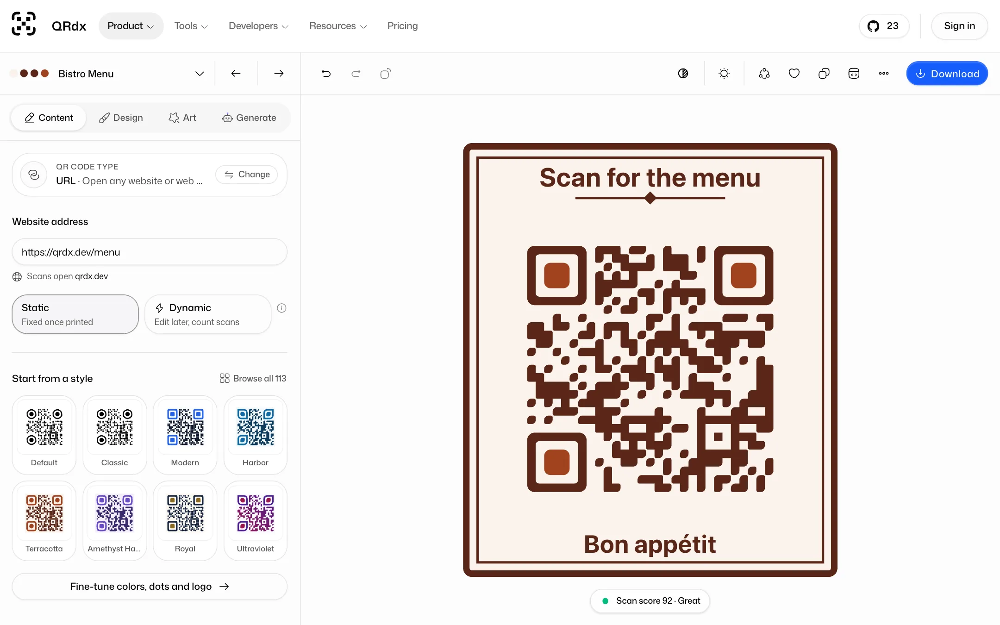
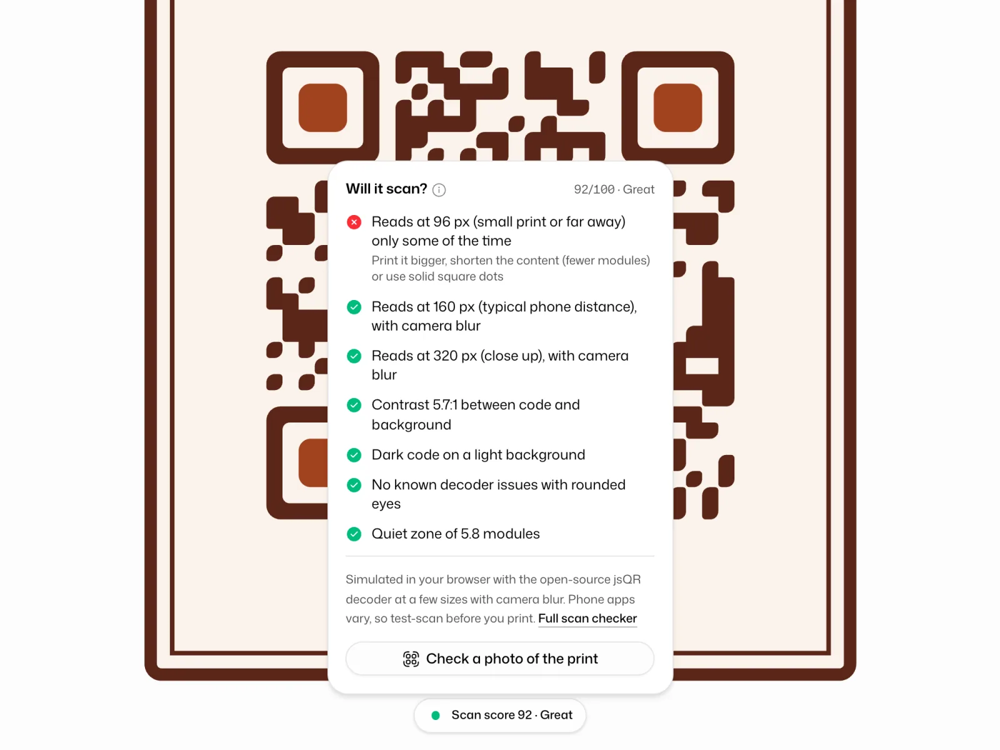
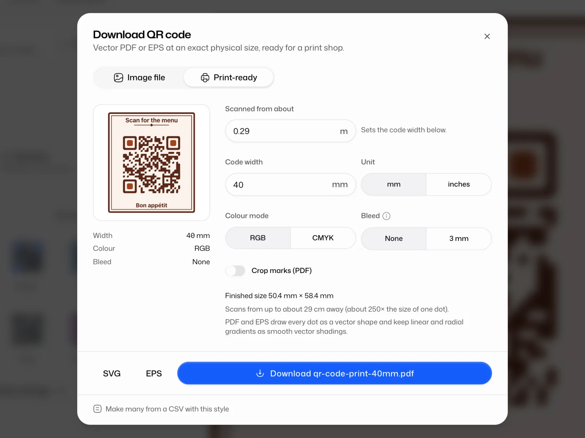
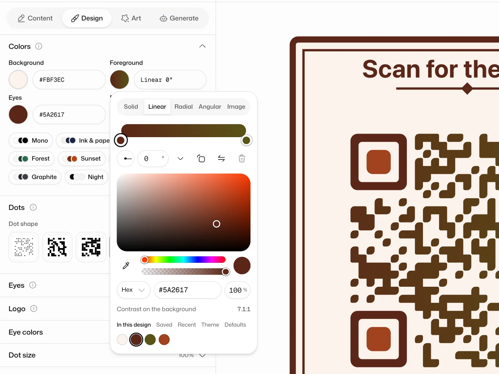
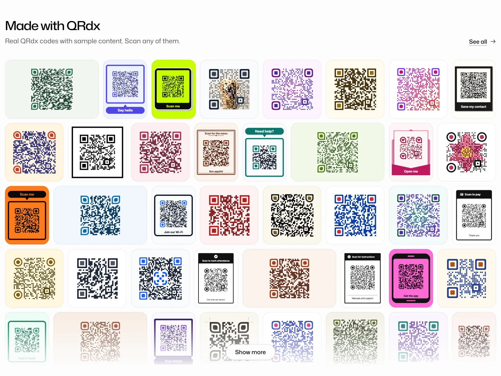

<h1 align="center">QRdx</h1>

<p align="center">
  An open-source QR code generator. Static codes are free with no sign-up or watermark. Dynamic codes come with hosted pages and scan analytics. Developers get an image API, an MCP server, a REST API, a CLI and a React library. You can self-host all of it.
</p>

<p align="center">
  <a href="https://qrdx.dev/playground"><strong>Open the playground</strong></a> ·
  <a href="https://qrdx.dev/docs">Docs</a> ·
  <a href="https://qrdx.dev/community">Community</a> ·
  <a href="https://qrdx.dev/pricing">Pricing</a>
</p>

<p align="center">
  <a href="LICENSING.md"></a>
  <a href="https://www.npmjs.com/package/qrdx"></a>
  <a href="https://github.com/bucharitesh/qrdx"></a>
</p>

<a href="https://qrdx.dev/playground?preset=restaurantMenu#url=https://qrdx.dev/menu">
  <picture>
    <source media="(prefers-color-scheme: dark)" srcset=".github/assets/playground-dark.webp">
    
  </picture>
</a>

<p align="center"><sub>The playground with the Bistro Menu style. <a href="https://assets.qrdx.dev/static/videos/playground-style-export.00d36ff737.mp4">Watch a 15-second clip</a> (MP4) of a link going from a sample code to a styled, framed one.</sub></p>

## Try it

- [Playground](https://qrdx.dev/playground): design a code and download it. No account needed.
- [The menu card above](https://qrdx.dev/playground?preset=restaurantMenu#url=https://qrdx.dev/menu), ready to edit.
- [Community](https://qrdx.dev/community): frames and themes people shared, free to use.
- [Docs](https://qrdx.dev/docs) for the editor, dynamic codes, the APIs and self-hosting.

## What you can do

**Design and download, free and without an account**

- Start from one of 113 built-in themes, or build a look from 23 body patterns, 17 corner-eye shapes and 21 eye centers. Add one of 19 call-to-action frames and edit its text right in the preview.
- Or give the code itself a shape: a circle of dots, a heart, or a silhouette traced in your browser from a PNG, JPEG or SVG you upload.
- Color the background, dots and eyes with a solid color, a linear, radial or angular gradient, a see-through color or a photo.
- Use the Art tab to blend a logo or photo into the dots (Logo QR and Image QR). They're vector art, so they export to every format. When you're signed in, AI art is there too.
- Describe the code you want in the Generate tab and an AI assistant designs it (5 free requests with an account).
- Check the scan score before you print. The playground decodes your design at 96, 160 and 320 px with simulated camera blur and tells you what to fix.
- Download PNG, JPG, SVG, PDF or EPS with no watermark. Print-ready PDF and EPS come at an exact size in mm or inches, in RGB or CMYK, with optional bleed and PDF crop marks. EPS can't carry a photo fill, so designs with one download as PDF, SVG or PNG.
- Browse the [community](https://qrdx.dev/community) for frames and themes, all shared under CC0.
- Free tools: a [bulk generator](https://qrdx.dev/tools/bulk) from CSV, a [scan checker](https://qrdx.dev/tools/scan-checker) for pictures of QR codes, a [print size calculator](https://qrdx.dev/tools/print-size) and a [QR code scanner](https://qrdx.dev/scan).

<table>
  <tr>
    <td width="50%" valign="top">
      <picture>
        <source media="(prefers-color-scheme: dark)" srcset=".github/assets/scan-check-dark.webp">
        
      </picture>
      <br><sub>The scan score, with a fix for each failed check.</sub>
    </td>
    <td width="50%" valign="top">
      <picture>
        <source media="(prefers-color-scheme: dark)" srcset=".github/assets/print-ready-dark.webp">
        
      </picture>
      <br><sub>Print-ready PDF and EPS at an exact size.</sub>
    </td>
  </tr>
  <tr>
    <td width="50%" valign="top">
      <picture>
        <source media="(prefers-color-scheme: dark)" srcset=".github/assets/color-picker-dark.webp">
        
      </picture>
      <br><sub>Solid colors, three kinds of gradient and photo fills.</sub>
    </td>
    <td width="50%" valign="top">
      <picture>
        <source media="(prefers-color-scheme: dark)" srcset=".github/assets/made-with-qrdx-dark.webp">
        
      </picture>
      <br><sub>Made with QRdx: real codes you can scan.</sub>
    </td>
  </tr>
</table>

**Dynamic codes and hosted pages, with a free account**

- Short links you can point somewhere else after printing, with scan analytics by country, city, device and browser.
- Hosted mobile pages: link lists, business pages, vCard Plus, menus, coupons, events, app links, forms with a response inbox, PDFs, galleries, audio and video.
- A dashboard for each workspace, with folders, tags, version history and a trash.
- Pro adds teams (owner, admin, member, billing and viewer roles), routing by device, country, language, time or scan count, A/B tests, passwords and expiry dates, custom domains and retargeting pixels. Business adds conversion tracking, webhooks and Slack or Discord alerts.

Free accounts get 10 dynamic codes and 3 hosted pages. Pro is $5 a month ($48 a year) and Business is $15 a month ($144 a year); see [pricing](https://qrdx.dev/pricing). Dynamic codes keep redirecting on every plan, even after a downgrade or a cancellation ([Never-Hostage Guarantee](https://qrdx.dev/guarantee)).

## For developers

**Image API.** A URL is the image, with no API key. Put it in a README, an `` tag or an email:

```md

```

Add `format=png` or `format=eps`, `size`, colors, patterns, a frame, a community item, or the whole design as JSON in `style`. See the [image API docs](https://qrdx.dev/docs/developers/image-api).

**MCP server.** Let an AI assistant design a code with a checked scan score, render it, look up styles and community frames, and build Wi-Fi, contact, email, SMS and location payloads. For Claude Code:

```bash
claude mcp add --transport http qrdx https://mcp.qrdx.dev/mcp
```

None of that needs an account. With a QRdx API key on the connection, `save_template` also saves a design to your workspace's themes. Cursor, VS Code and other clients: see the [MCP docs](https://qrdx.dev/docs/developers/mcp).

**REST API.** Create and edit dynamic codes (up to 100 per request on Pro and Business), read scan analytics, report conversions, subscribe to webhooks and read your saved themes under `https://api.qrdx.dev/v1`, with an API key or an OAuth 2.0 token. Every endpoint is in the [API reference](https://qrdx.dev/docs/developers/api), generated from the [OpenAPI document](https://qrdx.dev/openapi.json). Start with the [REST API docs](https://qrdx.dev/docs/developers/rest-api).

**React library.** [`packages/qrdx`](packages/qrdx) is the engine behind the playground.

> [!NOTE]
> npm still has `qrdx` 0.0.46. This repo has 0.0.47, which isn't published yet, and the [library README](packages/qrdx/README.md) documents 0.0.47. In 0.0.46 the basic code works, but most patterns, frames, Art QR, EPS export and the scan score came later, and it lists React 19, sharp and jspdf as its own dependencies. Until 0.0.47 is on npm, use the playground or the image API for those features. Run `npm view qrdx version` to see what npm installs.

```bash
npm install qrdx
```

```tsx
import { QRCodeSVG } from "qrdx";

export function Example() {
  return (
    <QRCodeSVG
      value="https://qrdx.dev"
      size={256}
      bodyPattern="circle"
      cornerEyePattern="gear"
      fgColor="#155DFC"
    />
  );
}
```

This example works with both 0.0.46 and 0.0.47.

**CLI.** [`@qrdx/cli`](packages/cli) renders styled codes from the terminal or CI:

```bash
npx @qrdx/cli generate "https://qrdx.dev" -o qr.svg
npx @qrdx/cli generate "https://qrdx.dev" -o qr.png --body circle --eye rounded --size 1024
```

> [!NOTE]
> npm still has `@qrdx/cli` 0.0.4. It has the qrdx 0.0.46 styles and no `--format` or `--frame`, and it writes SVG into a file named `qr.eps`. The repo's 0.0.5 adds EPS, frames and every current pattern but isn't published yet. For EPS today, use the image API: `curl -o qr.eps "https://api.qrdx.dev/v1/qr?data=https://qrdx.dev&format=eps"`.

**More**

- [shadcn/ui components](https://qrdx.dev/docs/developers/shadcn): `npx shadcn@latest add https://qrdx.dev/r/qr-code.json` adds a QR code with PNG and SVG downloads, and `qr-code-scanner.json` adds a scanner.
- [Agent skill](skills): `generate-qr` teaches coding agents to make QR codes with the CLI.
- Plugins: the [Chrome extension](https://chromewebstore.google.com/detail/bpepiomjdoicpmbihlohodghdglkhicc) is in the Chrome Web Store. The [Figma](plugins/figma), [Raycast](plugins/raycast) and [Canva](plugins/canva) plugins install from source.

## Self-hosting

You can run the whole web app yourself, dynamic codes and hosted pages included, with Docker Compose (Postgres included) or with Node.js. It needs three environment variables (`NEXT_PUBLIC_APP_URL`, `DATABASE_URL` and `BETTER_AUTH_SECRET`) and one way to sign in: a GitHub or Google OAuth app, or Resend for email sign-in codes. AI, payments, file storage, custom domains and the integrations are optional.

```bash
git clone https://github.com/bucharitesh/qrdx.git && cd qrdx
cp .env.example .env   # set BETTER_AUTH_SECRET and a sign-in method
docker compose up -d --build
```

Read the [self-hosting guide](https://qrdx.dev/docs/self-hosting) before you run it in production.

## License

- The web app and everything else in this repository outside the folders below are licensed under the [GNU Affero General Public License v3.0 or later](LICENSE). If you run a modified version as a network service, you have to offer its source code to its users under the same license.
- The React library ([`packages/qrdx`](packages/qrdx), from 0.0.47), the CLI ([`packages/cli`](packages/cli), from 0.0.5) and the plugins in [`plugins/`](plugins) are MIT-licensed, each with its own `LICENSE` file. Earlier npm releases of the library and the CLI were AGPL-3.0-or-later.
- The `ee/` folders ([`apps/docs/ee`](apps/docs/ee), [`packages/auth/ee`](packages/auth/ee)) hold business features, today workspace single sign-on, under the QRdx Commercial License in each folder's `LICENSE.md`. You can read, test and contribute to that code; using it in production needs a QRdx subscription or a written agreement. On a self-hosted instance these features stay off unless `QRDX_EE_LICENSE` is set.

[LICENSING.md](LICENSING.md) has the details.

The QRdx name and logo are trademarks. Read the [trademark policy](TRADEMARK.md) before you use them for a fork or a hosted service.

## Contributing

Bug reports, ideas and pull requests are welcome. [Open an issue](https://github.com/bucharitesh/qrdx/issues), or look for issues labeled `good first issue`. [CONTRIBUTING.md](CONTRIBUTING.md) covers local setup, the project layout and the checks to run. Report security issues privately, as [SECURITY.md](SECURITY.md) describes.

QRdx is a pnpm and Turborepo monorepo: a Next.js app with React, TypeScript, Tailwind CSS, Drizzle on Postgres, Better Auth and the Vercel AI SDK. QR generation started from [qrcode.react](https://github.com/zpao/qrcode.react), and the playground layout was inspired by [tweakcn](https://github.com/jnsahaj/tweakcn).

If QRdx is useful to you, a star helps other people find it.
